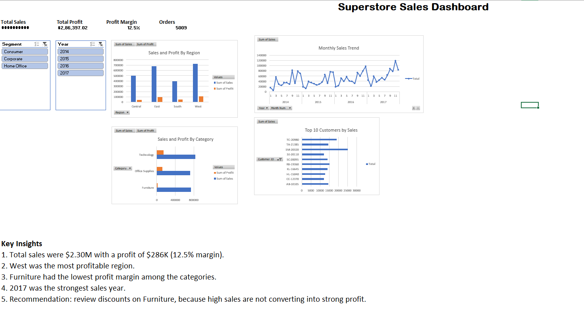

# Superstore Sales Dashboard (Excel)

## Objective
Analyze retail sales and profit to find top regions, weak categories and yearly trends.

## Dataset
Sample Superstore, from Kaggle. 9,994 rows. Values are in US dollars.

## Tools
Excel, Power Query, Tables, PivotTables, Slicers, Charts

## Process
1. Imported and cleaned the data with Power Query (fixed date formats and data types)
2. Added calculated columns: Year, Month Num, Month, Profit Margin
3. Built KPIs and four PivotTables (Region, Category, Monthly, Top Customers)
4. Added slicers (Year, Segment) and a one-page interactive dashboard
5. Validated that PivotTable grand totals match the SUM formula

Note: Sales, profit and margin KPIs respond to slicers; order count and average order value show overall totals.

## Key Findings
- Total sales: $2,297,200.86; total profit: $286,397.02 (12.5% margin)
- 5,009 orders; average order value $458.61
- West was the most profitable region
- Furniture had the lowest profit margin among the categories
- 2017 was the highest sales year

## Recommendation
Review discounting on Furniture, since high sales are not turning into strong profit.

## Screenshot

